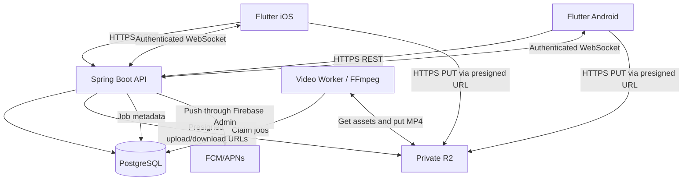

# 01 — Architecture & infrastructure

## Chosen approach
**Modular monolith** in one Spring Boot service. Module boundaries by feature, one PostgreSQL database. Avoid early microservices. A separate media worker is justified because transcoding is CPU-intensive, slow, and retryable.

## Data flow: photo
1. Client authenticates -> POST /api/v1/media/upload-intents with type/size/hash.
2. Server validates membership, quota, MIME and creates pending asset; returns short-lived signed PUT URL + uploadId/key.
3. Client uploads directly to R2 with progress/retry (not through Spring Boot).
4. POST /api/v1/media/{id}/complete; server HEADs object, checks content length/type and authorizes, persists READY.
5. Database transaction creates memory item and AFTER_COMMIT event/outbox; websocket broadcasts sanitized metadata; offline partner gets opt-in push.
6. Other user GETs authorized short-lived signed GET URL from API; caches safely; event IDs/reconciliation recover missed messages.
7. Cleanup job removes orphan pending objects and stale DB intents.

## Data flow: video recap
1. Scheduler uses pair timezone + user preferences, defines half-open date interval [start,end), selects READY media by captured_at and excludes hidden/deleted photos.
2. Insert idempotent `recap_job` with unique (pair_id, period_type, period_start, template_version) and a snapshot of selected media IDs; respects minimum photo count.
3. Worker atomically claims job, downloads authorized object bytes, renders 720p/1080p MP4 using FFmpeg binary in isolated environment, CPU/memory/time limits; use licensed or app-original soundtrack only.
4. Worker uploads output to private R2, marks READY/FAILED with attempts and technical diagnostics. API notifies pair.
5. Users preview, edit title, optionally regenerate; never publish by default. Retention, deletion, and regeneration are explicit.

## Flutter layers
Feature-first MVVM: presentation (page/widgets/controller), domain (entities/usecases as needed), data (repository/data source/DTO). Riverpod manages async state; Dio REST client; go_router typed navigation; secure local token storage. Repositories hide backend and cache details.

## Spring Boot modules
- auth: register/login, refresh, sessions, device tokens, reset/delete.
- couple: invite, pairing, membership, timezone, relationship date, unpair.
- milestones: anniversaries, custom reminder rules.
- moments: media metadata, timeline, reactions, ownership/deletion.
- plans: date ideas, events, tasks, attendance.
- finance: fund goals, contribution/expense ledger, derived balances.
- recaps: schedules, snapshot, jobs and outputs.
- notifications: preferences, FCM delivery, scheduled reminders.
- common: security, pagination, errors, audit, transactions, outbox.

## Operational baseline
Local: Flutter emulator / real phones; Docker Compose for PostgreSQL and optional R2 local mock (MinIO strictly dev). Backend profile dev/test/prod with environment variables. CI: backend unit+integration, Flutter analyze/test, migration check, secret scan, build. Production: reverse proxy TLS, API + worker isolated, database backups and restore drill, object quota/retention, logs and metrics (no tokens/photos), cost guardrails. Use R2 sandbox/staging first. CORS is not a substitute for authentication. Avoid public object ACLs.

## Security boundaries
- JWT/session validate on REST and websocket handshake/CONNECT; check pair membership for every message/subscription, not only connect.
- No client-supplied object key or pairId accepted as authorization. All resources are pair-scoped on server.
- Rate-limit upload intents, invite attempts and login, enforce per-object and cumulative storage quotas.
- Encrypt TLS in transit; limit presigned URL TTL; user data export and deletion workflow.
- Photos can contain GPS EXIF and private faces. Strip location metadata by default or store only explicit captions/date info.
- Debug logs must not include media URLs with signatures, tokens, addresses, personal notes.
- Do not enable unrestricted HTTP access or wildcard WebSocket subscription to all pairs.

## Deferred decisions
Check practical need for Redis, BullMQ-like queue, CDN and multi-instance broker only after load tests. For first release, persisted PostgreSQL jobs + outbox/event dispatcher are sufficient if implemented with skip-locked claims, retry/backoff and deduplication.
